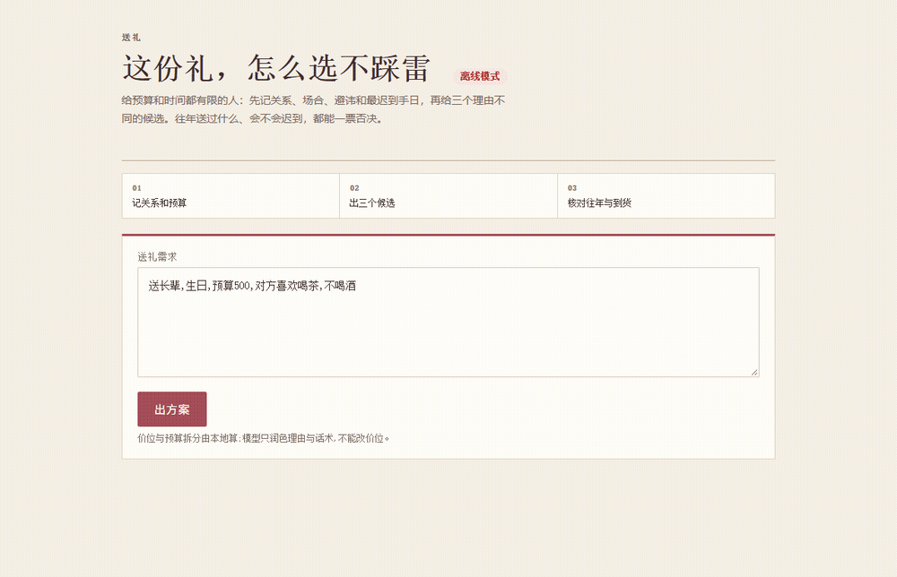
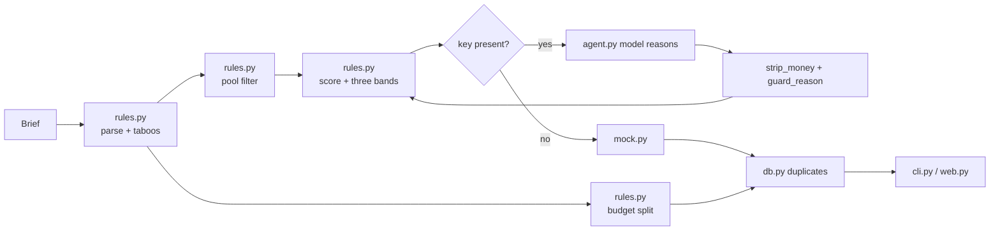

# SongLi · Gifting Plans

[](https://github.com/wushiyi105-jpg/songli/actions) []() [](./LICENSE) [](https://codecov.io/gh/wushiyi105-jpg/songli)



> Say who it is for, the occasion and the budget: three workable plans, plus taboos and what to say.

The hard part of gifting is not buying, it is "can I give this", "did I already give that", and "how should the money split". This tool filters a 200-item pool by relationship, occasion, price and taboos, computes the budget split, then returns three plans at different price bands. Gifts already given are recorded locally and skipped next time.

**CLI + Web, zero third-party dependencies.**

## ✨ Features

- 🎁 **200-item pool** — 86 product lines × three price tiers (entry / mid / premium), each tagged with relations, occasions and attributes
- 🚫 **31 taboo rules** — clocks, umbrellas, shoes, knives, white flowers, medicine, perfume, live pets, cash, luxury goods, religious items, pork, and more; a hit removes the item and suggests an alternative
- 💰 **Budget split** — main gift 80% / flowers 12% / card 4% / wrapping the remainder, rounded to ten, total always equals budget
- 🔁 **Duplicate check** — what you gave a person is stored, so the same item is skipped without relying on memory
- ⏰ **Timing** — birthdays, weddings, housewarming, newborns, hospital visits, workplace each have their own rule
- 🗣 **Scripts** — what to say by relationship, and how to respond when pushed back
- 🔒 **The model cannot change prices** — it writes reasons and lines only; any invented amount is discarded, prices always come from the local pool

## 🚀 Quick start

```bash
git clone https://github.com/wushiyi105-jpg/songli.git
cd songli

cp .env.example .env      # optional: LLM_API_KEY

python -m songli plan --text "For my grandmother, birthday, budget 500, likes tea, no alcohol"
```

Docker:

```bash
docker build -t songli .
docker run -p 8000:8000 songli

# or pull the multi-arch image (amd64 / arm64)
docker pull ghcr.io/wushiyi105-jpg/songli:latest
docker run -p 8000:8000 ghcr.io/wushiyi105-jpg/songli:latest
```

## 🤔 Why not just ask a general LLM

A general model says "tea is nice for an elder, 500 gets you a good box". It will not tell you how much of 500 belongs to flowers and a card, and it will not remember you gave tea last year. Four differences:

1. **The budget is computed** — `rules.split_budget(500)` gives main 400 / flowers 60 / card 20 / wrapping 20, total 500. Shop inside those four buckets instead of overspending then cutting flowers. The formula is fixed in code, not re-estimated each time.
2. **Taboos are a hard filter** — 31 rules match by keyword, so "perfume · mid" and "clock · premium" never enter the candidate set. A model can warn about clocks and recommend one in the same answer; that cannot happen here.
3. **Duplicates have a record** — `db.sent_names("grandmother")` returns what was given, and `rules.pool()` excludes it. Memory is unreliable, a table is not.
4. **Prices are immutable** — `130–430` comes from `data/gifts.json`. If a model reason contains `999`, that reason is dropped and the local wording is used.

## 🎯 Use cases

- **Elder's birthday**: budget 500, likes tea, no alcohol → tea box + candle + scarf, three price bands.
- **Colleague housewarming**: budget 200, safe choices, no knives or clocks.
- **Client holiday**: budget 800, avoid cash, alcohol and luxury, business-appropriate lines.
- **Newborn**: no plush or hard toys; cotton items with material confirmed.
- **Hospital visit**: ask the nurses' station about flowers first, then decide on fruit.

## 📂 Real examples

`examples/` holds 4 real briefs and their outputs, with sources in `cases.json`:

| Input | Source | What it should show |
|---|---|---|
| case-01 | Family group chat, grandmother's birthday, budget written as 「五百」 | Chinese numerals must read as 500; 「外婆」 maps to elder; "she doesn't drink" hits the alcohol taboo |
| case-02 | Colleague announcing a housewarming in the team chat | Clock and knife taboos both hit; no clock or knife in any of the three schemes |
| case-03 | Hospital visit arrangement, budget 300, wanted to bring flowers | Split totals 300; 「舅舅」 recognised as an elder |
| case-04 | Cousin announcing a full-moon party, plush allergy mentioned | The pool has no full-moon category yet; fall back by relation and say so in Risks |

```bash
for f in examples/case-*.txt; do python -m songli --mock plan --file "$f"; done
```

Archived outputs live in `examples/out/case-01..04.md`, byte-identical to what the CLI prints.

## 🗺 Roadmap

- **Pool expansion**: local specialities by city and season, with shelf life noted.
- **Group gifting**: differentiate when several people give at the same event.
- **Reciprocity**: record gifts received and suggest timing and price parity for return gifts.
- **Price calibration**: update ranges from actual retail prices with sources kept.
- **Custom taboos**: family-specific avoidances (numbers, colours) as local rules.

## ❓ FAQ

**Are these real prices?**
No. The `note` in `data/gifts.json` states they are reference ranges generated by category and tier for filtering and budget alignment; check the actual price before buying.

**Why does "no alcohol" trigger a taboo?**
`rules.taboo_hits()` scans your own words for taboo keywords; 酒 hits the alcohol rule, which flags the risk and suggests an alternative. It does not decide whether the person drinks, it surfaces the risk.

**Why are the three plans at different prices?**
`rules.schemes()` splits candidates into low / mid / high bands relative to the main-gift budget and takes one from each with distinct categories, so you get one high, one mid and one low rather than three variants at the same price.

**How are duplicates tracked?**
`--save` records recipient, occasion and plan in `data/songli.db`; next time the same recipient, `sent_names()` excludes those names.

**Will the model change a price?**
No. `agent.strip_money()` replaces amounts with a neutral phrase and `guard_reason()` rejects any reason containing one; prices are rendered only from local plans.

## 📖 Commands

```bash
# 🎁 three plans
python -m songli plan --text "Elder, birthday, budget 500, likes tea"
python -m songli plan --file brief.txt --save --recipient "Grandma"

# 🚫 taboo check only
python -m songli check --text "thinking of a clock"

# 🎁 candidate pool
python -m songli pool --text "Colleague, housewarming, budget 200"

# 🗂 gifts already given
python -m songli history --recipient "Grandma"

# 🌐 web
python -m songli web --port 8000

python -m songli --json plan --text "Friend, birthday, budget 200"
python -m songli --mock plan --text "Friend, birthday, budget 200"
```

## 🔌 Model configuration

Any **OpenAI-style `/chat/completions`** endpoint:

| Platform | `LLM_BASE_URL` | `LLM_MODEL` |
|---|---|---|
| DeepSeek (default) | `https://api.deepseek.com` | `deepseek-flash` |
| OpenAI | `https://api.openai.com/v1` | `gpt-4o-mini` |
| Local Ollama | `http://localhost:11434/v1` | `qwen2.5` |

## 🧠 How it works

```
relation / occasion / budget / interests / taboos / history
  │
  ├─ rules.parse ──────── relation, occasion, budget, interests, avoidances
  ├─ rules.taboo_hits ─── taboos in your own words
  ├─ rules.pool ───────── 200 items → relation/occasion/price/taboo/duplicate filter
  ├─ rules.score ──────── relation + occasion + price band + interests
  ├─ rules.schemes ────── one low / mid / high, distinct categories
  ├─ rules.split_budget ─ 80% / 12% / 4% / remainder
  ├─ rules.timing ─────── per-occasion rule
  │
  ├─ model: reasons / scripts / risks (strip_money + guard_reason)
  └─ offline: mock.py same-shape draft
  │
  └─ SQLite → CLI / Web
```

### Data flow



## 🗂 Layout

```
songli/
├── songli/
│   ├── rules.py    # parse, taboos, pool, scoring, budget, timing, scripts
│   ├── agent.py    # orchestration + money stripping and reason guard
│   ├── mock.py     # offline same-shape draft
│   ├── db.py       # gift history and plans
│   ├── cli.py      # plan / check / pool / history / web
│   └── web.py      # single page + JSON API
├── data/gifts.json     # 200-item pool
├── data/taboos.json    # 31 taboo rules
├── examples/           # 4 real briefs + archived output (sources in cases.json)
├── docs/regression-map.md  # issue → test name
├── tests/test_songli.py       # 28 unit tests
├── tests/test_integration.py  # 31 integration tests (HTTP / CLI / example verdicts)
└── assets/demo.gif
```

## ✅ Tests

```bash
python -m unittest discover tests -v
```

59 tests in two layers:

- **28 unit** (`tests/test_songli.py`): brief parsing, budget ranges, split totals, pool size and three filters, taboo hits, three bands with distinct categories, money stripping, reason guard, offline shape, history and duplicate exclusion.
- **31 integration** (`tests/test_integration.py`): a real `http.server` queried over raw sockets (page, `/api/plan`, `/api/history`, 404, truncated JSON), real subprocesses for `plan / check / pool / history`, and the verdicts of all four examples pinned one by one.

`docs/regression-map.md` records which test guards issues #3–#7 and why. CI runs on 3.10/3.11/3.12, ruff is clean, and pushing a `v*` tag builds a multi-arch image to GHCR.

## 👤 Author

Luo Zhizhi · 15071889700

## 📄 License

[MIT](./LICENSE)
