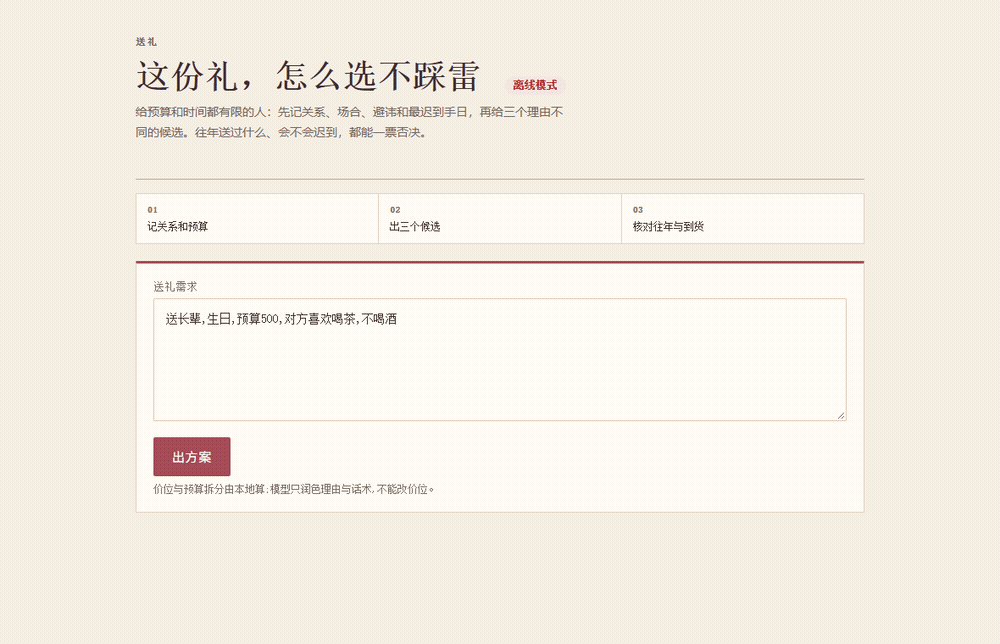
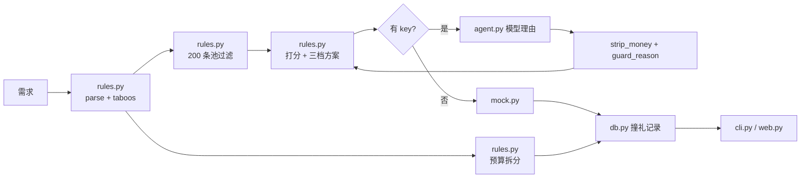

# 送礼 · 人情方案

[](https://github.com/wushiyi105-jpg/songli/actions) []() [](./LICENSE) [](https://codecov.io/gh/wushiyi105-jpg/songli)



> 说清楚送给谁、什么场合、多少预算:三套能落地的方案,连同避雷和话术。

送礼最难的不是买,是「这个能不能送」「会不会跟上次撞」「钱怎么分」。这个工具把 200 条礼物池按关系、场合、价位、禁忌先筛一遍,算出预算拆分,再给三套不同价位的方案;送过的礼记在本地,下次自动避开。

**CLI + Web,零第三方依赖。**

## ✨ 特性

- 🎁 **200 条礼物池** — 86 个品类 × 三档价位(入门 / 进阶 / 高端),每条带关系、场合、属性标签
- 🚫 **31 条禁忌规则** — 钟表、伞、鞋、刀具、白花、药品、香水、活体宠物、现金、奢侈品、宗教敏感、猪肉制品等,命中即从池里剔除并给替代
- 💰 **预算比例分配** — 主礼 80% / 花 12% / 卡 4% / 包装余额,四舍五入到十元,总额严格等于预算
- 🔁 **撞礼检查** — 记录某个人送过什么,同类直接跳过,不靠记性
- ⏰ **时机** — 生日、婚礼、乔迁、满月、探病、职场各有给法
- 🗣 **话术** — 按关系给当面说法,被推辞时怎么接
- 🔒 **模型不改价位** — 模型只写理由与话术,出现自造金额整条丢弃,价位永远来自本地池

## 🚀 快速开始

```bash
git clone https://github.com/wushiyi105-jpg/songli.git
cd songli

cp .env.example .env      # 可选:LLM_API_KEY

python -m songli plan --text "送长辈,生日,预算 500,喜欢喝茶,不喝酒"
```

Docker:

```bash
docker build -t songli .
docker run -p 8000:8000 songli
```

## 🤔 为什么不用通用大模型直接问

通用模型会说「送长辈茶叶不错,预算 500 可以买盒好茶」。它不会告诉你 500 里该留多少给花和卡,也不会记得你去年送过茶叶。差别在四点:

1. **预算是算出来的** — `rules.split_budget(500)` 给主礼 400 / 花 60 / 卡 20 / 包装 20,合计 500。买礼时按这四格走,不会主礼超支再砍花。公式写死在代码里,不是每次重新估。
2. **禁忌是硬过滤** — 31 条规则按关键词命中,池里的「香水·进阶」「钟表·高端」这类直接不进候选。模型可能一边说「送钟有风险」一边照样推荐,这里没有这种余地。
3. **撞礼有记录** — `db.sent_names("长辈")` 把送过的名字取出,`rules.pool()` 直接排除。人的记性靠不住,表靠得住。
4. **价位不许改** — 方案里的 `130–430 元` 来自 `data/gifts.json`;模型理由里只要出现 `999 元`,这条理由就丢弃,回退本地写法。

## 🎯 适用场景

- **给长辈过生日**:预算 500,喜欢喝茶,不喝酒 → 茶叶礼盒 + 香薰 + 围巾,三个价位段。
- **同事乔迁**:预算 200,不出错为主,避开刀具与钟表。
- **客户节日**:预算 800,避开现金、酒、奢侈品,话术按商务口径。
- **孩子满月**:避开毛绒与硬质玩具,优先棉品并确认材质。
- **探病**:先问护士站能不能带花,再决定水果还是别的。

## 🗺 Roadmap

- **礼物池扩充**:按城市与季节补本地特产,标注保质期。
- **多人同场**:同一场合多人送礼时做区分建议,避免撞款。
- **回礼管理**:记录收礼,提示回礼时机与价位对等。
- **价格带校准**:按电商实际成交价更新区间,保留来源。
- **禁忌自定义**:家庭自己的忌讳(数字、颜色)写进本地规则。

## ❓ FAQ

**价位是真实售价吗?**
不是。`data/gifts.json` 的 `note` 写明是区间参考,按品类与三档生成,用于筛选与预算对齐,下单前请按实际售价核对。

**「不喝酒」为什么会被识别成禁忌?**
`rules.taboo_hits()` 扫用户原话里的禁忌关键词,「酒」命中酒类规则,提示避开并给替代。它不会替你判断对方到底喝不喝,只把风险摆出来。

**三套方案为什么价位不同?**
`rules.schemes()` 按主礼预算把候选分成 low / mid / high 三档,每档取一条且品类不重复,所以拿到的是「一高一中一低」而不是三个同价位的变体。

**撞礼怎么记?**
`--save` 会把收礼人、场合、方案写进 `data/songli.db`;下次同一收礼人,`sent_names()` 里的名字直接排除。

**模型会改价格吗?**
不会。`agent.strip_money()` 把金额替换为「该价位」,`guard_reason()` 见到金额直接判不合格,价位只从本地方案渲染。

## 📖 命令参考

```bash
# 🎁 三套方案
python -m songli plan --text "送长辈,生日,预算 500,喜欢喝茶"
python -m songli plan --file brief.txt --save --recipient "外婆"

# 🚫 只查禁忌
python -m songli check --text "想送个钟"

# 🎁 看候选池
python -m songli pool --text "送同事,乔迁,预算 200"

# 🗂 送过的礼
python -m songli history --recipient "外婆"

# 🌐 Web
python -m songli web --port 8000

python -m songli --json plan --text "送朋友,生日,预算 200"
python -m songli --mock plan --text "送朋友,生日,预算 200"
```

## 🔌 模型接入

兼容 **OpenAI `/chat/completions`** 的任意服务:

| 平台 | `LLM_BASE_URL` | `LLM_MODEL` |
|---|---|---|
| DeepSeek(默认) | `https://api.deepseek.com` | `deepseek-flash` |
| OpenAI | `https://api.openai.com/v1` | `gpt-4o-mini` |
| 本地 Ollama | `http://localhost:11434/v1` | `qwen2.5` |

## 🧠 工作原理

```
关系 / 场合 / 预算 / 偏好 / 禁忌 / 送过的礼
  │
  ├─ rules.parse ──────── 关系、场合、预算、偏好、忌口
  ├─ rules.taboo_hits ─── 用户原话命中的禁忌
  ├─ rules.pool ───────── 200 条池 → 关系/场合/价位/禁忌/撞礼过滤
  ├─ rules.score ──────── 关系 + 场合 + 价位段 + 偏好
  ├─ rules.schemes ────── low / mid / high 各取一条,品类不重复
  ├─ rules.split_budget ─ 主礼 80% / 花 12% / 卡 4% / 包装余额
  ├─ rules.timing ─────── 场合给法
  │
  ├─ 模型:理由 / 话术 / 风险(strip_money + guard_reason)
  └─ 离线:mock.py 同结构草稿
  │
  └─ SQLite → CLI / Web
```

### 数据流



## 🗂 目录结构

```
songli/
├── songli/
│   ├── rules.py    # 解析、禁忌、池过滤、打分、预算、时机、话术
│   ├── agent.py    # 编排 + 金额剥离与理由校验
│   ├── mock.py     # 离线同结构草稿
│   ├── db.py       # 送礼记录与方案
│   ├── cli.py      # plan / check / pool / history / web
│   └── web.py      # 单页 + JSON API
├── data/gifts.json     # 200 条礼物池
├── data/taboos.json    # 31 条禁忌规则
├── tests/test_songli.py
└── assets/demo.gif
```

## ✅ 测试

```bash
python -m unittest discover tests -v
```

28 个单测:需求解析、预算区间、拆分总额、池数量与三类过滤、禁忌命中、三档方案与品类去重、金额剥离、理由校验拒绝未知礼物与自造价格、离线结构、记录与撞礼。CI 在 3.10/3.11/3.12 上跑。

## 👤 作者

罗之之 · 15071889700

## 📄 License

[MIT](./LICENSE)
